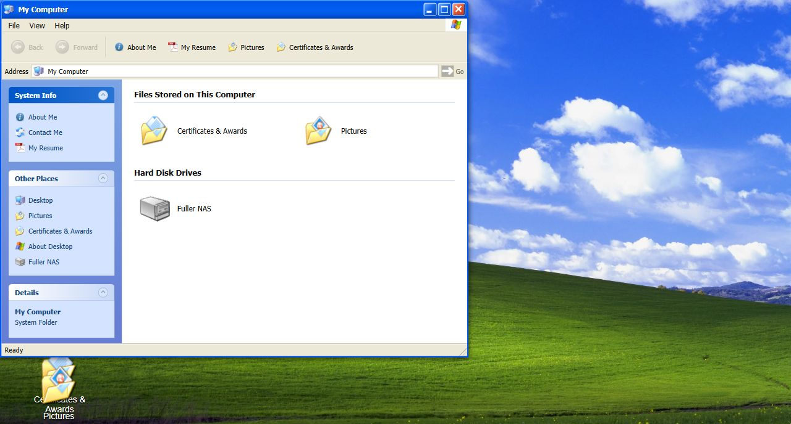
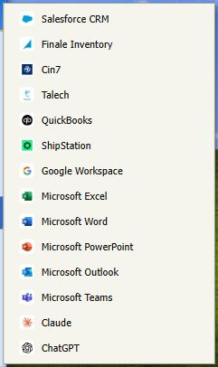
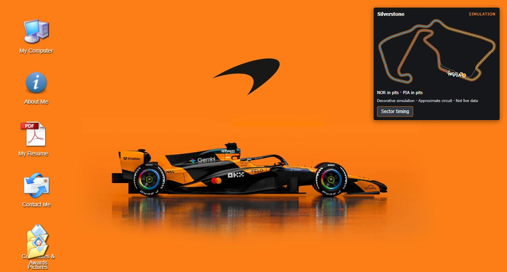
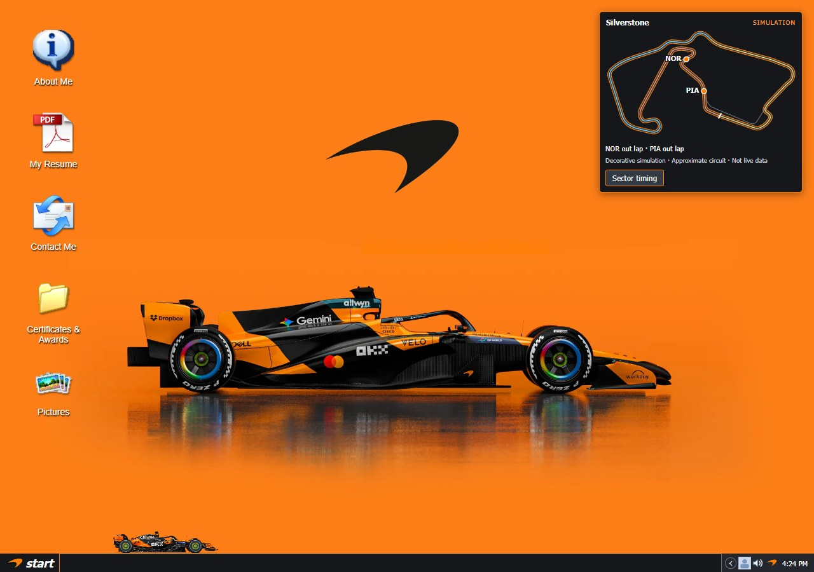
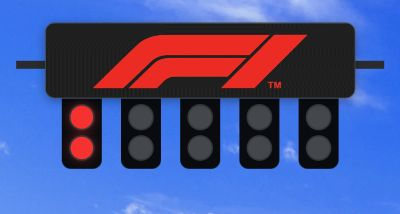
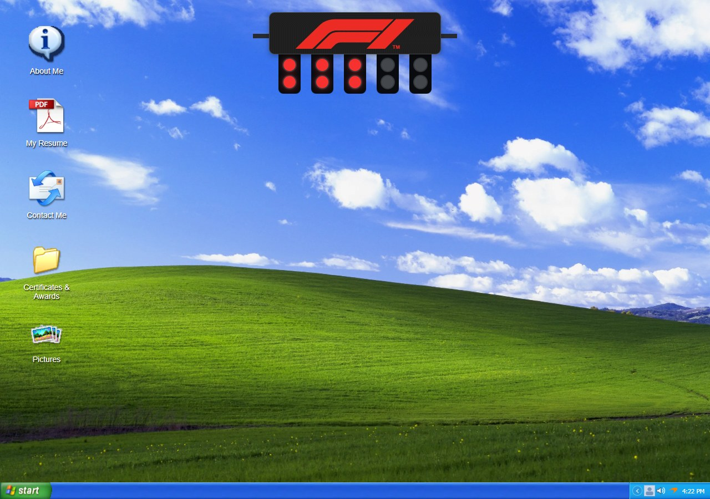
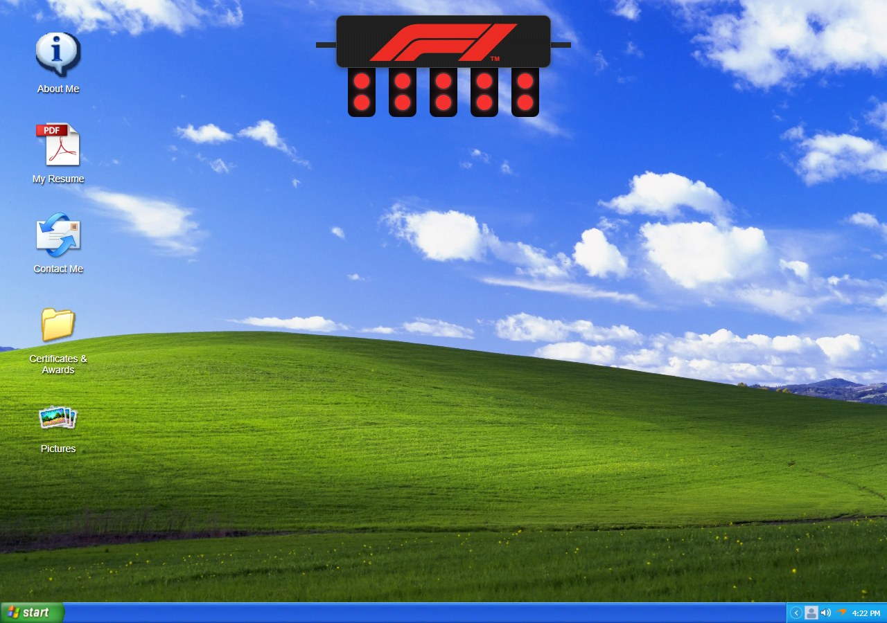

# NZJOSH XP

**Website version: 2026.11.18.4** · Updated November 18, 2026. This public source snapshot follows the current live interface, with personal data removed. See the [latest release](https://github.com/jjfuller/nzjosh-xp/releases/latest), [changelog](CHANGELOG.md) and [code walkthrough](docs/architecture.md).

An interactive Windows XP desktop in your browser. Explore Joshua Fuller's desktop, browse photos and certificates, chat with Josh Bot, and stay for a game.

[**Explore the desktop**](https://nzjosh.com/)

Works on desktop and phone. Open the site, select Josh's login tile, and dig around.


## On the desktop

- **About Josh.** Read personal and professional biographies, view his résumé, or get in touch from the desktop.
- **My Computer.** Explore connected folders, follow address-bar breadcrumbs, and open Pictures or Certificates without losing the desktop metaphor.
- **Pictures.** Explore albums in an Explorer-style window, with a rotating All pictures cover, thumbnail navigation, zoom, fit and rotation controls.
- **Certificates & awards.** Browse grouped credentials, awards and courses. Certificate thumbnails open an in-site document viewer with document download and print controls.
- **Other programs.** Chat with Josh Bot in a Messenger-style window, play Minesweeper, draw in Paint, use Calculator, or write a note in Notepad.
- **Desktop controls.** Move and resize windows, arrange shortcuts, select icons and explore the Start and tray menus.

## What's new in this snapshot

The November 18 refresh brings the newer Explorer and document components into the public project, alongside the latest desktop behaviour. The live site remains a personal portfolio; this repository is a reusable, blank-content version of its interface.

### My Computer and connected Explorer windows

My Computer is now a desktop entry point for Pictures, Certificates & Awards and other locations. Connected toolbars, File/View/Help menus and address breadcrumbs provide routes between them. Folder interactions select with a mouse click and open with a double-click; touch and pen interactions can open with one tap, and keyboard controls remain available.



[`my-computer.js`](site/my-computer.js) manages the folder shell and embedded views. [`explorer-path.js`](site/explorer-path.js) creates navigable breadcrumbs, while [`xp-icon-refresh.js`](site/xp-icon-refresh.js) keeps the current XP-style icons and navigation artwork consistent. The Pictures implementation lives in [`gallery-explorer.js`](site/gallery-explorer.js).

### Certificates and the document viewer

Credentials are grouped into LinkedIn, FEMA, Google, View All, Awards & Medals and Courses folders. Hover and keyboard-focus outlines make certificate thumbnails visibly interactive. The shared [`document-viewer.js`](site/document-viewer.js) supports image-based documents and PDFs, with navigation, zoom, download and print controls appropriate to documents.


The published [`certificates.js`](site/certificates.js) preserves this interface and event handling, but its personal certificate, award and course records are empty. The public package contains no certificate scans, credential IDs, resume documents or personal account links. Add only your own approved records and assets in a private copy.

### Classic first, Papaya for the current visit

Every fresh page visit and refresh starts in Classic. Leaving and returning, including back/forward restoration or switching away from the tab, also resets the appearance. Enter `papaya` in Command Prompt to activate the racing experience during the current visit, or `classic` to switch back. The previous persisted Papaya preference is removed.

This behaviour is handled in [`race-theme.js`](site/race-theme.js) using page and visibility events. Other preferences, such as the race-car toggle, have their own independent settings.

### Personal pictures: viewing deterrents, with clear limits

Personal picture windows disable image dragging, suppress image right-click saving and mobile touch callouts where supported, intercept save/print shortcuts in the photo window, and hide those windows in print styles. The protection is scoped to personal photos, so resume and certificate document downloads remain available.

[`picture-protection.js`](site/picture-protection.js) supplies the event handling; [`picture-protection.css`](site/picture-protection.css) supplies the drag, selection and print rules. **These are deterrents, not access control or DRM.** A browser must receive a photo to display it, so screenshots, developer tools, direct image requests and determined copying cannot reliably be prevented. The public template contains no personal albums.

### Product logos and clearer credits

The Start menu's Recently Used list shows software Joshua has used; it is not a visitor-activity tracker. Its 14 product entries now use locally hosted logos instead of generic letter tiles. [`software-logos.js`](site/software-logos.js) maps names to assets and records their sources. About this desktop lists the source links and rights notices.



Vendor artwork retains its owners' rights. The identified Simple Icons graphics have CC0-1.0 provenance, while trademark rights remain with their owners. The project's MIT License does not relicense third-party artwork; see [third-party notices](THIRD_PARTY_NOTICES.md).

## The McLaren-inspired desktop

A second appearance brings a little papaya to the desktop: orange highlights, charcoal panels, racing wallpaper and a matching taskbar.



The racing experience includes a five-light start sequence, an approximate Silverstone circuit simulation, a sector-timing display, and an animated taskbar car with a tray toggle. The circuit and timing are decorative simulations, not live race data. Motion settings and visibility handling help keep the experience comfortable.

The reusable application source is included; personal website content is excluded. The custom racing modules are in `site/race-theme.js`, `site/race-theme.css`, `site/race-circuit.js`, `site/race-timing.js`, `site/desktop-racer.js` and `site/desktop-racer.css`.

The appearance uses a single theme attribute and CSS palette variables:

```css
html[data-race-theme="active"] {
  --race-primary: #ff8000;
  --race-dark: #15171a;
  --race-panel: #23272d;
  --race-text: #ffffff;
}
```

Try the alternate appearance by entering `papaya` in Command Prompt. A five-light start sequence switches the desktop; enter `classic` to return to XP. The theme resets to Classic when the visit ends or the page refreshes, and respects reduced-motion preferences. These commands are handled by the included appearance controller rather than a separate framework.

### A McLaren across the taskbar

A cutout McLaren races along the top edge of the taskbar in both appearances. Each pass alternates direction, accelerates, cruises, then eases out of view. The car is decorative and does not intercept clicks on the desktop.



The wheels move independently of the body. Circular SVG clips isolate the front and rear wheels from the same transparent car image. Each animation frame rotates them by the distance the car has travelled, using `angle = distance / radius` in radians. This ties their rotation to road speed instead of running an unrelated wheel animation. At high angular speeds, a blurred wheel disc replaces the spokes to reduce flicker; a subtle body movement and trailing effect complete the pass.


These screenshots freeze the animation; open the live desktop to see the wheels turn. The implementation lives in [`desktop-racer.js`](site/desktop-racer.js) and [`desktop-racer.css`](site/desktop-racer.css), without an animation library.

- **Timing:** random 20–45 second gaps in Classic XP and 8–16 second gaps in the racing theme. Pass duration is now derived from travel distance and a target speed of roughly 750 screen pixels per second, with slight variation and a 0.9–2.8 second clamp. Car width adapts between 124 and 164 px, and resizing preserves an active pass's position.
- **Controls:** the papaya tray icon turns the car on or off and remembers that choice locally.
- **Motion and visibility:** animation pauses when the tab is hidden. Reduced-motion preferences disable it by default; explicitly enabling it uses a slower, simplified pass.

### Lights out: preparing the racing view

The five-second start sequence is also preparation time for the racing view. Entering `papaya` keeps the classic desktop visible while the gantry lights illuminate one paired column per second. The circuit begins preparing asynchronously during the countdown.

| Stage | What happens |
| --- | --- |
| 0–1 seconds | The first paired column lights up and circuit preparation starts. |
| 1–4 seconds | The remaining columns light in order, giving the circuit time to initialize while the visitor watches the sequence. |
| 4–5 seconds | All five paired columns are red. |
| At 5 seconds | The lights disappear together and the papaya appearance activates. |







The countdown calls `prepareCircuit()` immediately, which starts the asynchronous `mountCircuit()` work and avoids starting duplicate preparations. At five seconds, `completeCountdown()` removes the gantry and activates the theme. It is a fixed visual countdown, not a progress meter or a guarantee that every asset has finished loading. With reduced motion enabled, the countdown is skipped. Entering `classic` cancels an active sequence and restores XP.

See [`race-theme.js`](site/race-theme.js) for the sequence and theme controller, [`race-theme.css`](site/race-theme.css) for the gantry and lights, and [`race-circuit.js`](site/race-circuit.js) for circuit preparation. The McLaren, racing and Formula 1 artwork remains subject to the ownership notices below.

## Josh Bot — a local assistant without AI


Josh Bot brings a Messenger-style helper to the XP desktop. The cartoon avatar is a character image; the chatbot itself uses plain JavaScript and prepared answers. **No language model, AI API, API key or server-side inference is involved.** ChatGPT helped develop the project, but does not power visitors' conversations.


### How a reply is chosen

1. The chat loads a local [`joshbot-faq.json`](site/joshbot-faq.json) file containing prepared questions, keywords, answers and optional window actions.
2. [`localAnswer()`](site/joshbot-local.js) normalises the visitor's message, removes accents, converts it to lowercase and extracts word tokens. Common filler words are filtered out.
3. Simple rules handle greetings, a joke and certain requests for private details. Other questions are scored against the FAQ's question and keyword tokens: matched-word proportion plus a small bonus for each match.
4. The highest-scoring answer is returned if its score reaches `0.46`. Otherwise, Josh Bot says it does not know and points to Contact Me. It selects prepared text; it does not generate a new answer or learn from conversations.

This lightweight matching can misunderstand wording or choose an imperfect match. The privacy checks are basic scripted rules, not an AI safety system; keeping private material out of the FAQ is essential. If the FAQ cannot be loaded, a friendly fallback replaces the technical error.

### Chat controls and desktop actions

[`joshbot-chat.js`](site/joshbot-chat.js) builds the window with timestamps, avatars, a typing indicator, suggested questions and a Clear conversation control. Enter sends a message; Shift+Enter adds a line break. The typing delay is a presentation effect, not model processing.

Prepared replies can offer buttons to open approved windows such as Resume, Certificates & Awards, Pictures, Contact Me and Minesweeper. The action map in [`joshbot-messages.js`](site/joshbot-messages.js) limits which windows can be opened. Messages render as text rather than executing visitor-supplied HTML.

### XP-style reminders

[`joshbot-notifications.js`](site/joshbot-notifications.js) starts a configurable two-minute timer after login. It shuffles prompts from [`joshbot-notifications.json`](site/joshbot-notifications.json), adjusts wording for open windows and shows an XP-style tray balloon. These reminders are scripted too.

- Balloons pause while the tab is hidden and are deferred while chat, a focused game or a dialog would interrupt the visitor.
- The default session cap is eight balloons. Three consecutive dismissals double the interval, and each balloon auto-hides after ten seconds.
- Chat activity resets the timer. “Don't show these” remembers the visitor's preference, and the tray setting can enable them again.
- Notification sounds respect the site's mute setting.

### Where the data stays

Conversation history and notification messages are kept in this tab's `sessionStorage`, with up to 100 message entries retained. Notification preferences use `localStorage`. The chat makes local-file requests for its FAQ and notification pool; the implementation has no AI service or server-side chat logging. This describes Josh Bot's code, not a guarantee about browser extensions or third-party destination websites.

The public template deliberately contains only generic FAQ answers and blank profile fields. The live site's approved public answers are maintained separately. The cartoon avatar above is included for this showcase with Joshua's approval; private photo albums, resume documents and personal profile data remain excluded.

## Get started

1. Open [nzjosh.com](https://nzjosh.com/) and select Joshua's login tile.
2. Double-click a desktop shortcut with a mouse, or tap a shortcut on your phone.
3. Open Start to find more programs. Right-click the desktop for its context menu.
4. Use the connected window toolbars to move between About Me, My Resume, Pictures, and Certificates & Awards.

Some interactions adapt to touch screens and reduced-motion preferences.

## Run locally

This project uses plain HTML, CSS and JavaScript ES modules. No UI framework, API key or dependency installation is required for the static preview.

With Node.js 22 or newer:

```sh
npm start
```

Then open **http://127.0.0.1:4173/**. Serve the files over HTTP rather than opening index.html directly.

Run `npm run check` before publishing a modified public copy. It checks JavaScript syntax, local module references and the blank-profile boundary; it is not a complete security or accessibility audit.

```text
site/                Website client source and public assets
scripts/serve.mjs    Local preview server
docs/screenshots/   Screenshots from nzjosh.com
docs/architecture.md  Module map and implementation walkthrough
```

For static hosting, publish the `site/` directory. Production uses Cloudflare Workers with Static Assets. Its deployment adapter contains personal content and is deliberately excluded; the public client can run as static files. Account credentials, deployment tokens and private editor tools are not included. `site/_headers` contains response-header rules for compatible static hosts.

## About this repository

This repository contains the public-facing client code, assets and screenshots recovered from the newer live version of NZJOSH. It includes the McLaren-inspired racing features. Cloudflare-injected analytics and challenge scripts were removed from the distributable HTML because they are hosting features rather than application code.

The public repository is a **blank personal-content template**. Personal photo albums, photographic portraits, résumé documents, contact details, biography text, credentials and personal account links are excluded. The Josh Bot cartoon avatar is an explicitly approved showcase image. Profile fields and photo albums are empty; certificates show a placeholder and Josh Bot contains only generic help answers. Visit the live website to view Josh's content.

To personalize a private copy, populate `site/profile.json` with your own public profile and gallery entries, then provide your own approved assets. Do not commit private data, `.env` files or deployment credentials.

## Credits

- **Joshua Fuller** — creator, project direction, design decisions, content and final review.
- **[ChatGPT](https://chatgpt.com/) by OpenAI** — assistance with implementation, debugging, documentation and design iteration. This credit acknowledges AI assistance; it does not imply OpenAI endorsement or repository membership.
- Third-party artwork, icons, fonts, trademarks and photographs belong to their respective owners. See [asset credits](site/CREDITS.md) and [in-app notices](site/legal-notices.js).

## Community and support

Read the [contribution guidelines](CONTRIBUTING.md), [code of conduct](CODE_OF_CONDUCT.md), [security policy](SECURITY.md), [accessibility statement](ACCESSIBILITY.md) and [support guide](SUPPORT.md) before opening an issue or pull request. Use the issue templates for bug reports and feature requests. Never attach private photographs, certificates, contact details, credentials or personal website exports.

## Copyright and permissions

Joshua Fuller's original code and documentation are available under the **[MIT License](LICENSE)**. Third-party images, photographs, fonts and trademarks retain their own rights and are not relicensed by this project; read [THIRD_PARTY_NOTICES.md](THIRD_PARTY_NOTICES.md) before reusing assets. NZJOSH is a personal fan project and is not affiliated with or endorsed by Microsoft, McLaren, Formula 1 or OpenAI.
