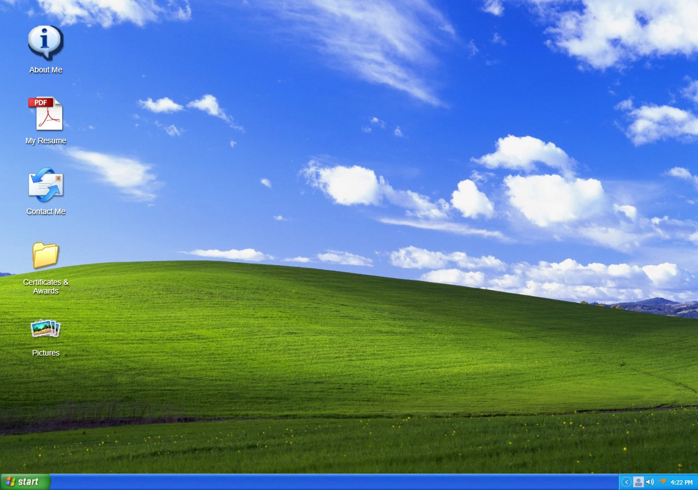
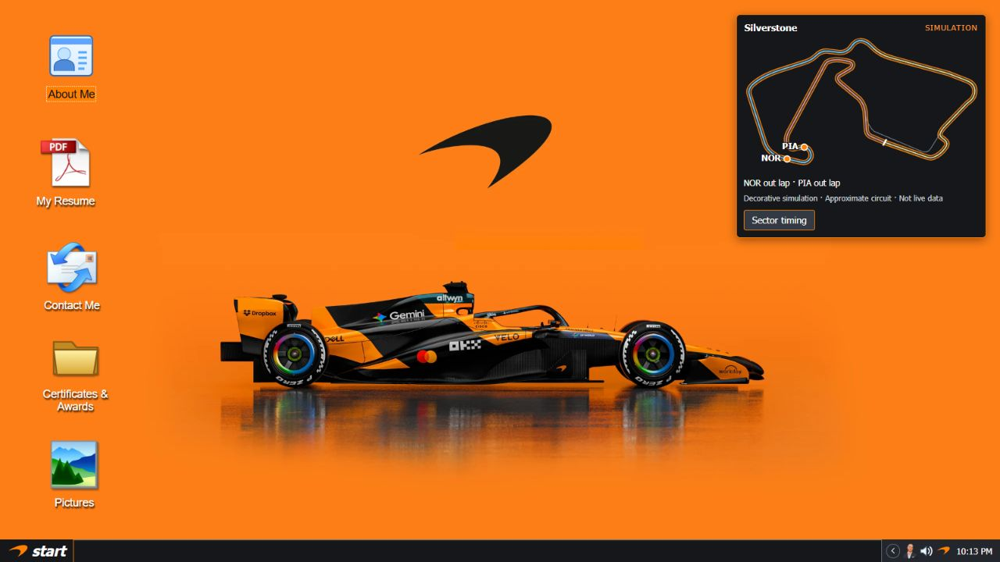

# NZJOSH XP

An interactive Windows XP desktop in your browser. Explore Joshua Fuller's desktop, browse photos and certificates, chat with Josh Bot, and stay for a game.

[**Explore the desktop**](https://nzjosh.com/)

Works on desktop and phone. Open the site, select Josh's login tile, and dig around.



## On the desktop

- **About Josh.** Read personal and professional biographies, view his résumé, or get in touch from the desktop.
- **Pictures.** Explore photo albums in Image Viewer, with a rotating All pictures cover.
- **Certificates & awards.** Browse certificates, awards, medals and completed courses.
- **Other programs.** Chat with Josh Bot in a Messenger-style window, play Minesweeper, draw in Paint, use Calculator, or write a note in Notepad.
- **Desktop controls.** Move and resize windows, arrange shortcuts, select icons and explore the Start and tray menus.

## The McLaren-inspired desktop

A second appearance brings a little papaya to the desktop: orange highlights, charcoal panels, racing wallpaper and a matching taskbar.



The racing experience includes a five-light start sequence, an approximate Silverstone circuit simulation, a sector-timing display, and an animated taskbar car with a tray toggle. The circuit and timing are decorative simulations, not live race data. Motion settings and visibility handling help keep the experience comfortable.

The reusable application source is included; personal website content is excluded. The custom racing modules are in `site/race-theme.js`, `site/race-theme.css`, `site/race-circuit.js`, `site/race-timing.js`, `site/desktop-racer.js` and `site/desktop-racer.css`.

The appearance uses a single theme attribute and CSS palette variables:

```css
html[data-race-theme="active"] {
  --race-primary: #ff8000;
  --race-dark: #15171a;
  --race-panel: #23272d;
  --race-text: #ffffff;
}
```

Try the alternate appearance by entering `papaya` in Command Prompt. A five-light start sequence switches the desktop; enter `classic` to return to XP. The theme remembers its setting locally and respects reduced-motion preferences. These commands are handled by the included appearance controller rather than a separate framework.

## Get started

1. Open [nzjosh.com](https://nzjosh.com/) and select Joshua's login tile.
2. Double-click a desktop shortcut with a mouse, or tap a shortcut on your phone.
3. Open Start to find more programs. Right-click the desktop for its context menu.
4. Use the connected window toolbars to move between About Me, My Resume, Pictures, and Certificates & Awards.

Some interactions adapt to touch screens and reduced-motion preferences.

## Run locally

This project uses plain HTML, CSS and JavaScript ES modules. No UI framework, API key or dependency installation is required for the static preview.

With Node.js 22 or newer:

```sh
npm start
```

Then open **http://127.0.0.1:4173/**. Serve the files over HTTP rather than opening index.html directly.

```text
site/                Website client source and public assets
scripts/serve.mjs    Local preview server
docs/screenshots/   Screenshots from nzjosh.com
```

For static hosting, publish the `site/` directory. Production uses Cloudflare Workers with Static Assets. Account credentials, deployment tokens and private editor tools are not included. `site/_headers` contains the public response-header rules for compatible hosts.

## About this repository

This repository contains the public-facing client code, assets and screenshots recovered from the newer live version of NZJOSH. It includes the McLaren-inspired racing features. Cloudflare-injected analytics and challenge scripts were removed from the distributable HTML because they are hosting features rather than application code.

The public repository is a **blank personal-content template**. It contains no personal photos, portrait files, résumé documents, contact details, biography text, credentials or account links. Profile fields and photo albums are empty; certificates show a placeholder and Josh Bot contains only generic help answers. Visit the live website to view Josh's content.

To personalize a private copy, populate `site/profile.json` with your own public profile and gallery entries, then provide your own approved assets. Do not commit private data, `.env` files or deployment credentials.

Created by **Joshua Fuller & ChatGPT**.

Public source availability does not by itself grant a reuse license. A code license has not yet been selected. Third-party images, trademarks and assets retain their respective rights; see [asset credits](site/CREDITS.md) and [in-app notices](site/legal-notices.js). NZJOSH is a personal fan project and is not affiliated with or endorsed by Microsoft, McLaren or Formula 1.
